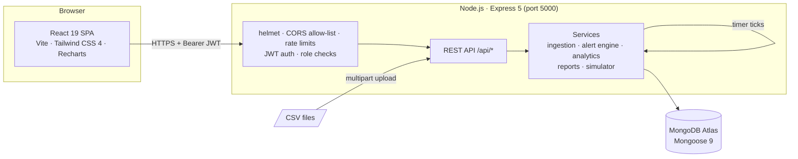
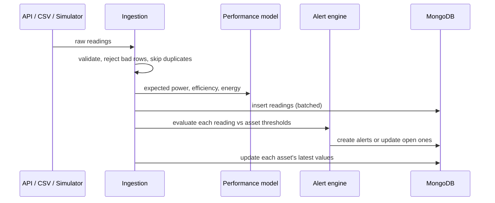

# Renewable Energy Monitoring System (REMS)

REMS is a web application for monitoring renewable energy generation from solar panels and wind turbines, alongside the inverters, batteries and transformers around them. It ingests telemetry, derives performance figures, raises alerts when assets misbehave, tracks maintenance work, and produces reports.

REMS is software-only: no IoT hardware is needed. Telemetry arrives through the API, through CSV uploads, or from the built-in simulator.

## Features

| Area | What it does |
|---|---|
| **Dashboard** | KPIs (total generation, peak power, fleet efficiency, open alerts) with trends against the previous period; actual vs expected power, daily or cumulative energy, and plant/asset breakdown charts |
| **Plants & assets** | Plants with location and capacity; assets of five types (solar panel, wind turbine, inverter, battery storage, transformer) with live telemetry snapshots, activate/deactivate, and maintenance flags |
| **Telemetry** | JSON and streamed CSV ingestion; each reading is enriched with expected power, efficiency (performance ratio) and running energy; sortable, filterable data explorer |
| **Alerts** | Rule engine for zero generation, low efficiency, unexplained output drops, over-temperature, high wind, low battery charge and reported faults; repeat detections are deduplicated; acknowledge and resolve with notes |
| **Simulator** | Background generator with a daily sun curve, drifting wind, battery cycling and an accelerated clock; inject anomalies to exercise the alert engine |
| **Maintenance** | Work orders (preventive, corrective, inspection) with priority, schedule, technician, cost and notes; enforced status workflow and full status history; board and table views |
| **Reports** | Plant performance, alert incident frequency and fleet telemetry export; daily, weekly or monthly grouping; CSV and JSON downloads; report history |
| **Users & access** | Admin-managed accounts and roles, temporary passwords, password reset, "sign out everywhere", self-service password change |

## Architecture



**How a reading flows through the system**



### Repository layout

```
REMS/
├── client/                 React app (Vite)
│   └── src/
│       ├── api/            axios client + one module per resource
│       ├── components/     ui/, layout/, auth/, charts/, alerts/, maintenance/, ...
│       ├── context/        AuthProvider, AlertsProvider, breadcrumbs
│       ├── pages/          one component per route (data-heavy pages lazy-loaded)
│       └── router.jsx      routes, guards and error elements
├── server/                 Express API
│   ├── app.js              middleware and routes (no listening)
│   ├── server.js           DB connection, listen, graceful shutdown
│   ├── models/             Mongoose schemas
│   ├── controllers/        request handlers
│   ├── routes/             routers + role checks
│   ├── services/           ingestion, alert engine, analytics, reports, simulator
│   ├── middleware/         auth, sanitising, error handling
│   ├── scripts/            create-admin, build check, production start
│   └── samples/            sample telemetry CSV
└── package.json            root scripts (build, start)
```

## Roles and permissions

New self-registered accounts are **Viewers**. Admins grant other roles on the Users page.

| Capability | Admin | Operator | Viewer |
|---|:---:|:---:|:---:|
| View dashboard, plants, assets, telemetry, alerts, maintenance | ✓ | ✓ | ✓ |
| Generate and download reports | ✓ | ✓ | ✓ |
| Delete reports | ✓ (any) | own | own |
| Create and edit plants; register, edit, (de)activate assets | ✓ | ✓ | |
| Ingest telemetry (API and CSV upload) | ✓ | ✓ | |
| Acknowledge and resolve alerts | ✓ | ✓ | |
| Create work orders and change their status | ✓ | ✓ | |
| Start/stop the simulator and inject anomalies | ✓ | ✓ | |
| Manage users, roles, password resets and sessions | ✓ | | |

The API enforces every rule above; the UI hides actions a role can't use. Role changes take effect on the user's next request and their screen updates within a minute.

## Getting started

### Prerequisites

- Node.js **20.19+** (22 or 24 recommended) and npm
- A MongoDB Atlas cluster (or a local MongoDB 5.0+)

### 1. Install

```bash
git clone https://github.com/komcy/Renewable-Energy-Monitoring-System.git
cd Renewable-Energy-Monitoring-System
npm run install:all
```

### 2. Configure

```bash
cp server/.env.example server/.env
cp client/.env.example client/.env
```

Then edit `server/.env` (see the [environment variables](#environment-variables) below). At minimum, set `MONGO_URI` and a long random `JWT_SECRET`:

```bash
node -e "console.log(require('crypto').randomBytes(48).toString('hex'))"
```

### 3. Create the first Admin

```bash
npm run create-admin --prefix server -- "Your Name" you@example.com "A-Strong-Password1"
```

### 4. Run in development

Use two terminals:

```bash
npm run dev:server
```

```bash
npm run dev:client
```

Open http://localhost:5173. The API runs on http://localhost:5000 (`GET /api/health` reports database status).

To get data quickly, sign in as the Admin, open **Simulator**, set a time scale of 60 and a start hour of 6, then press **Start**. Or upload `server/samples/sample_telemetry.csv` from **Telemetry → Upload CSV**.

## Production build and start

```bash
npm run build
```

This builds the client into `client/dist` and runs the server check, which syntax-checks every server file and loads the whole app.

```bash
npm start
```

This starts the API with `NODE_ENV=production`; it also serves the built client and handles client-side routes. In production the server **refuses to start** unless `JWT_SECRET` is at least 32 characters. Behind a reverse proxy, set `TRUST_PROXY=1` and add your public URL to `CLIENT_URL`.

## Environment variables

**`server/.env`**

| Variable | Default | Purpose |
|---|---|---|
| `PORT` | `5000` | API port |
| `NODE_ENV` | `development` | `production` serves `client/dist` and requires a strong secret |
| `MONGO_URI` | (required) | MongoDB connection string |
| `JWT_SECRET` | (required) | Token signing secret; 32+ random characters |
| `JWT_EXPIRES_IN` | `1d` | Token lifetime |
| `CLIENT_URL` | `http://localhost:5173` | Allowed browser origins (comma-separated) |
| `TRUST_PROXY` | (unset) | Set to `1` behind a reverse proxy so rate limits see real IPs |
| `AUTH_RATE_LIMIT` | `20` | Failed sign-in attempts allowed per 15 min per IP |
| `API_RATE_LIMIT` | `3000` | API requests per 15 min per IP |
| `SIM_TIMEZONE` | `Asia/Kolkata` | Timezone of the simulator's day/night cycle |
| `SIMULATOR_AUTOSTART` | `false` | Start the simulator when the server starts |
| `SIMULATOR_INTERVAL_SECONDS` | `10` | Autostart tick interval |
| `SIMULATOR_TIME_SCALE` | `1` | Autostart clock speed |

**`client/.env`**

| Variable | Default | Purpose |
|---|---|---|
| `VITE_API_URL` | `http://localhost:5000/api` | API base URL (use `/api` when the server serves the client) |

## API overview

All routes are under `/api`. Every route except `auth/login`, `auth/register` and `health` needs `Authorization: Bearer <token>`.

| Resource | Endpoints |
|---|---|
| Auth | `POST auth/register` · `POST auth/login` · `GET auth/me` · `POST auth/change-password` |
| Users (Admin) | `GET/POST users` · `PUT users/:id` · `POST users/:id/reset-password` · `POST users/:id/revoke-sessions` |
| Plants | `GET/POST plants` · `GET/PUT/DELETE plants/:id` |
| Assets | `GET/POST assets` · `GET/PUT/DELETE assets/:id` · `PATCH assets/:id/status` |
| Telemetry | `POST telemetry` · `POST telemetry/upload` (CSV) · `GET telemetry` · `GET telemetry/latest` · `GET telemetry/aggregate` |
| Alerts | `GET alerts` · `GET alerts/active` · `GET alerts/summary` · `GET alerts/counts` · `GET alerts/:id` · `PATCH alerts/:id/acknowledge` · `PATCH alerts/:id/resolve` |
| Analytics | `GET analytics/dashboard` |
| Maintenance | `GET/POST maintenance` · `GET maintenance/summary` · `GET/PUT/DELETE maintenance/:id` · `PATCH maintenance/:id/status` |
| Reports | `GET/POST reports` · `GET/DELETE reports/:id` · `GET reports/:id/download?format=csv\|json` |
| Simulator | `GET simulator/status` · `POST simulator/start` · `POST simulator/stop` · `POST simulator/anomaly` |

Work orders move **Scheduled → In Progress → Completed**. Either open status can move to **Cancelled** (a reason is required), and a cancelled order can be rescheduled. Completing requires notes describing the work done.

## Security and resilience

- **Passwords and sessions:** passwords are hashed with bcrypt. JWTs carry a per-user version, so a password change or reset, a deactivation or "sign out everywhere" invalidates existing tokens immediately.
- **Request protection:** `helmet` security headers, including a Content Security Policy for the served client; a CORS allow-list; rate limiting of failed sign-ins and of overall API use; and rejection of MongoDB operator keys (`$gt`, dotted paths) in request bodies and queries.
- **CSV exports:** cells are escaped against spreadsheet formula injection.
- **Server resilience:** graceful shutdown on `SIGINT`/`SIGTERM` (the simulator stops, connections close, then the database disconnects), and a clean exit on unhandled errors so a process manager can restart the server.
- **Client resilience:** a React error boundary plus route-level error pages, which show a "new version available" prompt if a page's code changed after deploy.

## Academic context

This project was developed for a Software Engineering course. It demonstrates requirements analysis (SRS), UML-based design, a modular architecture, database design, testing and documentation.

### Contributors

- Komal Jadhav (2024300087)
- Pritam Jadhav (2024300088)
