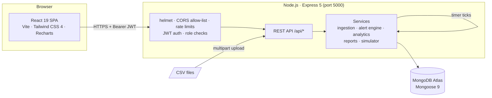
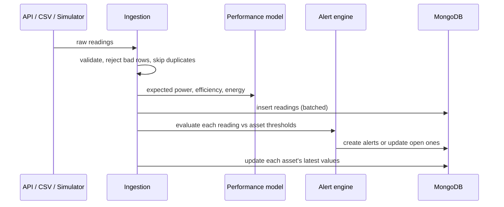

# Renewable Energy Monitoring System (REMS)

REMS is a web application for monitoring renewable energy generation from solar panels and wind turbines, alongside the inverters, batteries and transformers around them. It ingests telemetry, derives performance figures, raises alerts when assets misbehave, tracks maintenance work, and produces reports.

REMS is software-only: no IoT hardware is needed. Telemetry arrives through the API, through CSV uploads, or from the built-in simulator.

## Features

| Area | What it does |
|---|---|
| **Dashboard** | KPIs (total generation, peak power, fleet efficiency, open alerts) with trends against the previous period; actual vs expected power, daily or cumulative energy, and plant/asset breakdown charts |
| **Plants & assets** | Plants with location and capacity; assets of five types (solar panel, wind turbine, inverter, battery storage, transformer) with live telemetry snapshots, activate/deactivate, and maintenance flags |
| **Telemetry** | JSON and streamed CSV ingestion; each reading is enriched with expected power, efficiency (performance ratio) and running energy; sortable, filterable data explorer |
| **Alerts** | Rule engine for zero generation, low efficiency, unexplained output drops, over-temperature, high wind, low battery charge and reported faults; repeat detections are deduplicated; acknowledge and resolve with notes |
| **Simulator** | Background generator with a daily sun curve, drifting wind, battery cycling and an accelerated clock; inject anomalies to exercise the alert engine |
| **Maintenance** | Work orders (preventive, corrective, inspection) with priority, schedule, technician, cost and notes; enforced status workflow and full status history; board and table views |
| **Reports** | Plant performance, alert incident frequency and fleet telemetry export; daily, weekly or monthly grouping; CSV and JSON downloads; report history |
| **Users & access** | Admin-managed accounts and roles, temporary passwords, password reset, "sign out everywhere", self-service password change |

## Architecture



**How a reading flows through the system**



### Repository layout

```
REMS/
├── client/                 React app (Vite)
│   └── src/
│       ├── api/            axios client + one module per resource
│       ├── components/     ui/, layout/, auth/, charts/, alerts/, maintenance/, ...
│       ├── context/        AuthProvider, AlertsProvider, breadcrumbs
│       ├── pages/          one component per route (data-heavy pages lazy-loaded)
│       └── router.jsx      routes, guards and error elements
├── server/                 Express API
│   ├── app.js              middleware and routes (no listening)
│   ├── server.js           DB connection, listen, graceful shutdown
│   ├── models/             Mongoose schemas
│   ├── controllers/        request handlers
│   ├── routes/             routers + role checks
│   ├── services/           ingestion, alert engine, analytics, reports, simulator
│   ├── middleware/         auth, sanitising, error handling
│   ├── scripts/            create-admin, build check, production start
│   ├── test/               integration + unit tests (node:test)
│   └── samples/            sample telemetry CSV
├── scripts/dev.js          starts API and client together (npm run dev)
├── Dockerfile              multi-stage production image
├── docker-compose.yml      container orchestration (+ optional local MongoDB)
└── package.json            root scripts (dev, test, build, start, docker:*)
```

## Roles and permissions

New self-registered accounts are **Viewers**. Admins grant other roles on the Users page.

| Capability | Admin | Operator | Viewer |
|---|:---:|:---:|:---:|
| View dashboard, plants, assets, telemetry, alerts, maintenance | ✓ | ✓ | ✓ |
| Generate and download reports | ✓ | ✓ | ✓ |
| Delete reports | ✓ (any) | own | own |
| Create and edit plants; register, edit, (de)activate assets | ✓ | ✓ | |
| Ingest telemetry (API and CSV upload) | ✓ | ✓ | |
| Acknowledge and resolve alerts | ✓ | ✓ | |
| Create work orders and change their status | ✓ | ✓ | |
| Start/stop the simulator and inject anomalies | ✓ | ✓ | |
| Manage users, roles, password resets and sessions | ✓ | | |

The API enforces every rule above; the UI hides actions a role can't use. Role changes take effect on the user's next request and their screen updates within a minute.

## Getting started

### Prerequisites

- Node.js **20.19+** (22 or 24 recommended) and npm
- A MongoDB Atlas cluster (or a local MongoDB 5.0+)

### 1. Install

```bash
git clone https://github.com/komcy/Renewable-Energy-Monitoring-System.git
cd Renewable-Energy-Monitoring-System
npm run install:all
```

### 2. Configure

```bash
cp server/.env.example server/.env
cp client/.env.example client/.env
```

Then edit `server/.env` (see the [environment variables](#environment-variables) below). At minimum, set `MONGO_URI` and a long random `JWT_SECRET`:

```bash
node -e "console.log(require('crypto').randomBytes(48).toString('hex'))"
```

### 3. Create the first Admin

```bash
npm run create-admin --prefix server -- "Your Name" you@example.com "A-Strong-Password1"
```

### 4. Run in development

```bash
npm run dev
```

This starts the API (nodemon, auto-restart, port 5000) and the client (Vite, hot reload, port 5173) together, with `[server]` / `[client]` prefixed output. Ctrl+C stops both. To run them in separate terminals instead, use `npm run dev:server` and `npm run dev:client`.

Open http://localhost:5173. The API runs on http://localhost:5000 (`GET /api/health` reports database status).

To get data quickly, sign in as the Admin, open **Simulator**, set a time scale of 60 and a start hour of 6, then press **Start**. Or upload `server/samples/sample_telemetry.csv` from **Telemetry → Upload CSV**.

## Production build and start

```bash
npm run build
```

This builds the client into `client/dist` and runs the server check, which syntax-checks every server file and loads the whole app.

```bash
npm start
```

This starts one server on port 5000 with `NODE_ENV=production`. It serves the API under `/api`, serves the built client, and returns `index.html` for client-side routes such as `/plants/123`; unknown `/api/*` routes still return JSON 404s. Open http://localhost:5000; the Vite server on 5173 isn't used.

In production the server **refuses to start** unless `JWT_SECRET` is at least 32 characters. Behind a reverse proxy, set `TRUST_PROXY=1` and add your public URL to `CLIENT_URL`. Requests from the server's own origin are always allowed.

## Testing

```bash
npm test
```

This runs 40 tests with Node's built-in test runner (no extra dependencies):

| Suite | Covers |
|---|---|
| `auth.test.js` | Registration always as Viewer; JWT issuance and claims; missing, malformed and forged tokens; deactivated accounts; password change rotating the token; operator-injection rejection |
| `rbac.test.js` | Authentication on every route; Viewer read access and a 403 for every write/control action; Operator vs Admin rights; role changes and session revocation taking effect on the next request |
| `telemetry.test.js` | Expected power, efficiency and trapezoidal energy for a batch; ZeroGeneration, OverTemperature, LowEfficiency and LowStateOfCharge alerts; deduplication of repeats; all-or-nothing batch rejection; duplicates; deactivated assets; hourly aggregation |
| `production.test.js` | SPA served at `/` with security headers, client-route fallback, JSON 404s for `/api`, immutable asset caching, CORS for own vs foreign origins (skipped if the client isn't built) |
| `units.test.js` | Performance model, alert rules and CSV escaping (no database) |

The integration tests start the real app on a random port against a **separate database**: your `MONGO_URI` with `_test` appended to the database name (`rems` → `rems_test`), or `TEST_MONGO_URI` if set. That database is wiped before and after each suite, and the harness refuses any database whose name doesn't end in `_test`. For the database-free tests only, run `npm run test:unit --prefix server`.

## Docker

The multi-stage `Dockerfile` builds the client, installs production-only server dependencies and produces a slim image. It runs as a non-root user, serves the UI and API on port 5000, and has a health check on `/api/health`. Secrets are never baked into the image (`.dockerignore` excludes `.env` files); they're supplied at runtime from `server/.env`.

```bash
docker compose up --build -d
```

Then open http://localhost:5000 (`docker compose ps` shows the container as healthy). Stop it with `docker compose down`.

**Local MongoDB instead of Atlas:** set `MONGO_URI=mongodb://mongo:27017/rems` in `server/.env`, then start with the bundled database:

```bash
docker compose --profile local-db up --build -d
```

**Image only:**

```bash
docker build -t rems .
docker run --env-file server/.env -p 5000:5000 rems
```

Optional compose variables: `REMS_PORT` (host port, default 5000) and `REMS_PUBLIC_URL` (the URL users open, default `http://localhost:5000`).

## Environment variables

**`server/.env`**

| Variable | Default | Purpose |
|---|---|---|
| `PORT` | `5000` | API port |
| `NODE_ENV` | `development` | `production` serves `client/dist` and requires a strong secret |
| `MONGO_URI` | (required) | MongoDB connection string |
| `JWT_SECRET` | (required) | Token signing secret; 32+ random characters |
| `JWT_EXPIRES_IN` | `1d` | Token lifetime |
| `CLIENT_URL` | `http://localhost:5173` | Extra allowed browser origins, comma-separated (the server's own origin is always allowed) |
| `TRUST_PROXY` | (unset) | Set to `1` behind a reverse proxy so rate limits see real IPs |
| `AUTH_RATE_LIMIT` | `20` | Failed sign-in attempts allowed per 15 min per IP |
| `API_RATE_LIMIT` | `3000` | API requests per 15 min per IP |
| `SIM_TIMEZONE` | `Asia/Kolkata` | Timezone of the simulator's day/night cycle |
| `SIMULATOR_AUTOSTART` | `false` | Start the simulator when the server starts |
| `SIMULATOR_INTERVAL_SECONDS` | `10` | Autostart tick interval |
| `SIMULATOR_TIME_SCALE` | `1` | Autostart clock speed |

**`client/.env`**

| Variable | Default | Purpose |
|---|---|---|
| `VITE_API_URL` | `http://localhost:5000/api` | API base URL (use `/api` when the server serves the client) |

## API reference

All routes are under `/api` and return JSON (`{ success, data, ... }` on success, `{ success: false, message, details? }` on error). Send `Authorization: Bearer <token>` on every route marked with a role. In the Access column, **Any** means any signed-in user, and **Ops** means Admin or Operator.

**Auth and users**

| Method | Path | Access | Description |
|---|---|---|---|
| GET | `/health` | Public | API and database status |
| POST | `/auth/register` | Public | Create an account (always Viewer); returns a token |
| POST | `/auth/login` | Public | Sign in; returns a token (failed attempts are rate-limited) |
| GET | `/auth/me` | Any | Current user |
| POST | `/auth/change-password` | Any | Change own password; returns a new token, signs out other sessions |
| GET | `/users` | Admin | List users (`search`, `role`, `status`, paging) with role counts |
| POST | `/users` | Admin | Create a user; without a password, returns a one-time `temporaryPassword` |
| PUT | `/users/:id` | Admin | Update name, email, role or active status |
| POST | `/users/:id/reset-password` | Admin | Issue a temporary password and sign the user out |
| POST | `/users/:id/revoke-sessions` | Admin | Sign the user out everywhere |

**Plants and assets**

| Method | Path | Access | Description |
|---|---|---|---|
| GET | `/plants` | Any | List plants (`plantType`, `status`, `search`) with asset counts |
| GET | `/plants/:id` | Any | Plant with assets, open alerts and per-asset open maintenance |
| POST | `/plants` | Ops | Create a plant |
| PUT | `/plants/:id` | Ops | Update a plant (partial; location merges) |
| DELETE | `/plants/:id` | Ops | Delete a plant with no assets |
| GET | `/assets` | Any | List assets (`plant`, `sourceType`, `status`, `search`) |
| GET | `/assets/:id` | Any | Asset with latest reading and open-alert count |
| POST | `/assets` | Ops | Register an asset (type-specific specs and thresholds) |
| PUT | `/assets/:id` | Ops | Update specs, thresholds or details |
| PATCH | `/assets/:id/status` | Ops | Activate or deactivate (deactivated assets reject telemetry) |
| DELETE | `/assets/:id` | Ops | Delete an asset with no telemetry history |

**Telemetry, alerts and analytics**

| Method | Path | Access | Description |
|---|---|---|---|
| POST | `/telemetry` | Ops | Ingest one reading, an array, or `{ readings: [...] }` (up to 5,000; all-or-nothing) |
| POST | `/telemetry/upload` | Ops | Stream a CSV (`multipart/form-data`, field `file`); good rows stored, bad rows reported by line |
| GET | `/telemetry` | Any | Raw readings (`plant`, `asset`, `from`, `to`, `status`, `source`, `sortBy`, `sort`, paging) |
| GET | `/telemetry/latest` | Any | Newest reading per asset (`plant`) |
| GET | `/telemetry/aggregate` | Any | Hourly/daily buckets (`interval`, `plant`/`asset`, `sourceType`, `from`, `to`, `timezone`) |
| GET | `/alerts` | Any | List alerts (`status`, `severity`, `alertType`, `plant`, `asset`, dates, paging) |
| GET | `/alerts/active` | Any | Open alerts, most severe first |
| GET | `/alerts/summary` | Any | Open alerts by severity and status |
| GET | `/alerts/counts` | Any | Counts by severity for given filters |
| GET | `/alerts/:id` | Any | Alert with asset, reading and lifecycle |
| PATCH | `/alerts/:id/acknowledge` | Ops | Acknowledge an active alert |
| PATCH | `/alerts/:id/resolve` | Ops | Resolve with `resolutionNotes` |
| GET | `/analytics/dashboard` | Any | KPIs with previous-period trends, fleet status, plant/asset breakdown |

**Maintenance, reports and simulator**

| Method | Path | Access | Description |
|---|---|---|---|
| GET | `/maintenance` | Any | Work orders (`status`, `priority`, `type`, `plant`, `asset`, `search`, `overdue`) |
| GET | `/maintenance/summary` | Any | Open, overdue, completed and cost this month |
| GET | `/maintenance/:id` | Any | Work order with history and allowed next statuses |
| POST | `/maintenance` | Ops | Create a work order for an asset |
| PUT | `/maintenance/:id` | Ops | Edit an open work order (cost and notes only once closed) |
| PATCH | `/maintenance/:id/status` | Ops | Change status (`status`, `note`, plus `technicianNotes`/`cost` when completing) |
| DELETE | `/maintenance/:id` | Ops | Delete a scheduled or cancelled work order |
| GET | `/reports` | Any | Report history (`reportType`, `plant`, paging) |
| POST | `/reports` | Any | Generate (`reportType`, `plant`, `from`, `to`, `granularity`, `timezone`) |
| GET | `/reports/:id` | Any | Report with rows |
| GET | `/reports/:id/download` | Any | Download as `format=csv` or `json` (telemetry exports are streamed) |
| DELETE | `/reports/:id` | Admin or author | Delete a report |
| GET | `/simulator/status` | Any | Simulator state, counters, recent alerts |
| POST | `/simulator/start` | Ops | Start (`intervalSeconds`, `timeScale`, `startHour`, `durationMinutes`, `anomalyRate`, `plant`) |
| POST | `/simulator/stop` | Ops | Stop |
| POST | `/simulator/anomaly` | Ops | Inject an anomaly (`assetCode`, `type`, `ticks`) |

Work orders move **Scheduled → In Progress → Completed**. Either open status can move to **Cancelled** (a reason is required), and a cancelled order can be rescheduled. Completing requires notes describing the work done.

## Security and resilience

- **Passwords and sessions:** passwords are hashed with bcrypt. JWTs carry a per-user version, so a password change or reset, a deactivation or "sign out everywhere" invalidates existing tokens immediately.
- **Request protection:** `helmet` security headers, including a Content Security Policy for the served client; a CORS allow-list; rate limiting of failed sign-ins and of overall API use; and rejection of MongoDB operator keys (`$gt`, dotted paths) in request bodies and queries.
- **CSV exports:** cells are escaped against spreadsheet formula injection.
- **Server resilience:** graceful shutdown on `SIGINT`/`SIGTERM` (the simulator stops, connections close, then the database disconnects), and a clean exit on unhandled errors so a process manager can restart the server.
- **Client resilience:** a React error boundary plus route-level error pages, which show a "new version available" prompt if a page's code changed after deploy.

## Academic context

This project was developed for a Software Engineering course. It demonstrates requirements analysis (SRS), UML-based design, a modular architecture, database design, testing and documentation.

### Contributors

- Komal Jadhav (2024300087)
- Pritam Jadhav (2024300088)
